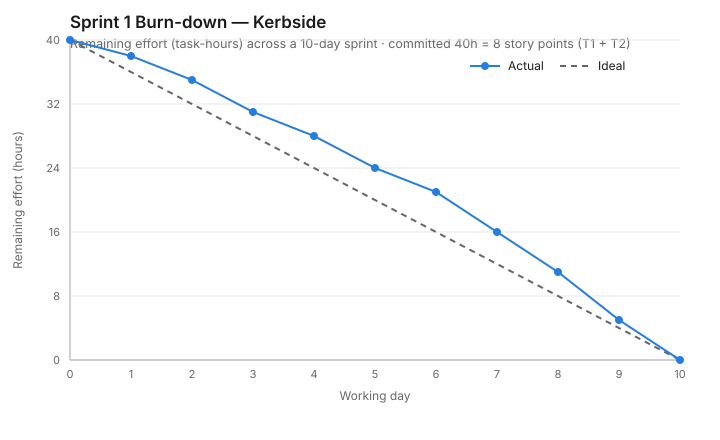

# 09 — Burn-down Chart (Sprint 1)

*(Assignment Part 2, task 2: "Create a burn-down chart for one of the sprints".)*

We chart **Sprint 1** of Release 1. Sprint 1 commits **8 story points** = **T1 (CI/CD, 3)** + **T2 (Core data model, 5)**, broken into tasks totalling **40 hours** (see the task breakdown in [doc 08](08-sprint-backlog-and-planning.md)). The burn-down tracks **remaining task-hours** across the 10 working days, against the ideal straight-line burn.

> The chart is also at [`assets/burndown-sprint1.svg`](../assets/burndown-sprint1.svg). Blue = actual remaining effort; grey dashed = ideal.

## Data (accessible table view)

| Working day | Ideal remaining (h) | Actual remaining (h) |
|---:|---:|---:|
| 0 | 40 | 40 |
| 1 | 36 | 38 |
| 2 | 32 | 35 |
| 3 | 28 | 31 |
| 4 | 24 | 28 |
| 5 | 20 | 24 |
| 6 | 16 | 21 |
| 7 | 12 | 16 |
| 8 | 8 | 11 |
| 9 | 4 | 5 |
| 10 | 0 | 0 |

- **Ideal line:** 40 h → 0 h, a constant −4 h/day.
- **Actual line:** stayed **above** the ideal through days 1–8 (the team tracked slightly behind — schema migrations took longer than estimated) and **recovered** by day 10 to finish on time.

## How to read it

- **Line above ideal** ⇒ behind schedule / at risk (what happened mid-sprint here).
- **Line below ideal** ⇒ ahead of schedule.
- **Flat segment** ⇒ no effort burned that day (a blocker, or effort spent on work not yet "done").
- **Ends at 0 on day 10** ⇒ the sprint commitment was completed.

## What the team concluded (Sprint 1 review & retro)

- **Outcome:** both committed stories (T1, T2) completed — Sprint 1 goal met.
- **Risk signal:** the persistent gap above the ideal line from day 4 onward flagged the schema task as under-estimated; the SM raised it in the day-5 stand-up.
- **Recovery:** the team protected the sprint goal by de-scoping the *nice-to-have* seed-data variety (kept a minimal seed) rather than dropping a committed task — a Must-protecting move consistent with our MoSCoW discipline.
- **Retro action:** size data/migration tasks with a complexity buffer next sprint; keep committing a conservative 8 points while the team's true velocity stabilises.

> **Note on story-point vs task-hour burn-downs.** We burn **task-hours** here because, with only two stories, a *story-point* burn-down would show just two large steps (8 → 5 → 0) and hide the mid-sprint risk. Task-hour tracking gives the daily granularity a burn-down is meant to provide. Both reconcile: 40 h of tasks == the 8 committed points.
